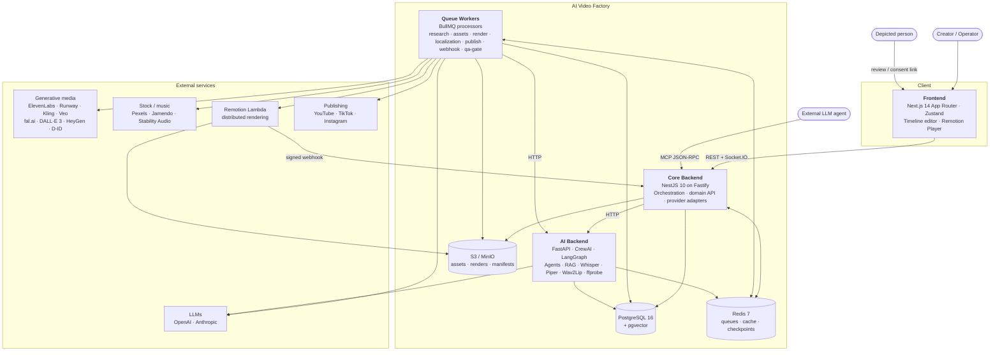
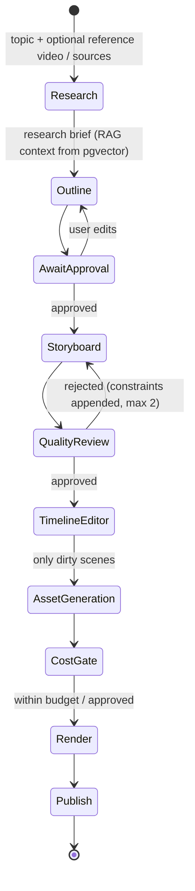
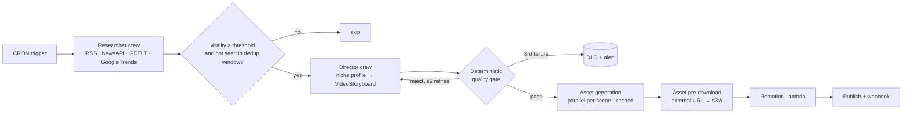
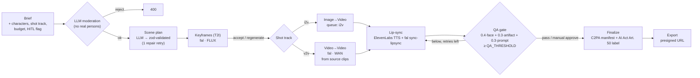

<div align="center">

# AI Video Factory

**Event-driven, multi-provider platform for AI-assisted video production: from research and scripting through synthetic media generation and programmatic rendering to multi-platform publishing.**

[](https://github.com/bwolak94/video-publisher/actions/workflows/ci.yml)


</div>

---

## Table of Contents

1. [Executive Summary](#1-executive-summary)
2. [Architecture Drivers](#2-architecture-drivers)
3. [Solution Architecture](#3-solution-architecture)
4. [Production Pipelines](#4-production-pipelines)
5. [Provider Strategy](#5-provider-strategy)
6. [Cross-Cutting Concerns](#6-cross-cutting-concerns)
7. [Architecture Decision Records](#7-architecture-decision-records)
8. [Data Architecture](#8-data-architecture)
9. [API Surface](#9-api-surface)
10. [Repository Layout](#10-repository-layout)
11. [Getting Started](#11-getting-started)
12. [Quality Engineering](#12-quality-engineering)
13. [Implementation Status & Roadmap](#13-implementation-status--roadmap)

---

## 1. Executive Summary

Producing video with generative AI isn't one model call. It's a long-running, failure-prone **workflow** that spans a dozen paid third-party APIs. Each step has different latency, cost, rate limits and failure modes. AI Video Factory treats that workflow as a distributed system problem. The pipeline is a chain of **durable, retryable, observable jobs**. Every external provider sits behind a **port with fallbacks**. Every paid call is gated by **deterministic validation and cost controls**.

The platform supports three production modes on a shared core:

| Mode | Audience | Orchestration | Human involvement |
|---|---|---|---|
| **Creator Mode** (long-form) | Creators editing 16:9 videos | LangGraph state machine with interrupt points, then a timeline editor | Human-in-the-loop at outline, storyboard and per-scene level |
| **Worker Mode** (autopilot) | Faceless channels | CRON trigger, then a CrewAI sequential crew (research, direct, review) | None. Fully autonomous, with dedup and virality threshold |
| **Shorts Studio** (9:16) | Character-driven short-form | LLM scene plan → keyframes → image/video-to-video → lip-sync → QA gate → C2PA finalize | Optional HITL on keyframes, QA and likeness review |

Beyond generation, the platform covers what turns a demo into a product:

- localization and dubbing
- brand kits
- A/B thumbnail and narration experiments
- competitor gap analysis
- review links for stakeholders
- likeness-consent management
- an **MCP server** that lets external LLM agents drive the editor

## 2. Architecture Drivers

These are the quality attributes that shaped the design, in priority order.

| # | Driver | Why it matters here | Primary tactics |
|---|---|---|---|
| QA-1 | **Cost control** | A single video can trigger 50+ paid API calls. A bug in a retry loop costs real money. | Deterministic quality gate *before* spend. Content-addressed asset cache. Pre-generation cost estimate. Budget approval gate. Per-provider cost ledger. |
| QA-2 | **Resilience to third-party failure** | 10+ external providers. At least one is always degraded. | Circuit breakers, provider fallback chains, `Promise.allSettled` per scene, exponential backoff, DLQ |
| QA-3 | **Long-running workflow durability** | Renders take minutes. HITL sessions take hours. | BullMQ persistent jobs, LangGraph Redis checkpoints, Postgres ↔ queue state sync |
| QA-4 | **Modifiability / provider churn** | The generative-AI vendor landscape changes monthly | Hexagonal provider ports, registry pattern, a canonical `VideoStoryboard` contract |
| QA-5 | **Compliance & trust** | Synthetic media of real people is a legal and reputational risk | Likeness consent vault, subject film review, C2PA provenance manifest, EU AI Act Art. 50 disclosure label, prompt-safety screening |
| QA-6 | **Observability** | Debugging a 9-stage async pipeline needs correlation | Correlation-ID propagation, structured JSON logs, Prometheus RED metrics, alert rules |
| QA-7 | **Scalability of compute-heavy steps** | Rendering and inference don't fit on API nodes | Rendering offloaded to Remotion Lambda. Inference isolated in a Python service. Workers scale horizontally per queue. |

**Constraints:** small team. Polyglot by necessity: the agent ecosystem is Python-first, and the media/render ecosystem (Remotion, googleapis) is Node-first. Local development must work with **no cloud account** (MinIO replaces S3).

## 3. Solution Architecture

### 3.1 Container view (C4 Level 2)



### 3.2 Service responsibilities

| Container | Owns | Does **not** own |
|---|---|---|
| **Core Backend** (`core-backend/`) | Identity, projects, scenes, cost ledger, queue topology, all media and publishing provider adapters, render dispatch, real-time events, MCP endpoint | LLM agent logic, embeddings, local ML inference |
| **AI Backend** (`ai-backend/`) | Research crew, director (script/storyboard), creator-mode graph, deterministic quality review, RAG ingestion, local inference (faster-whisper, Piper TTS, Wav2Lip), media analysis (ffprobe, reference-video pacing) | Persistence of business entities, queueing, provider billing |
| **Frontend** (`frontend/`) | Creator UX: chat-driven creation, virtualized timeline editor, live preview, Shorts studio, libraries, review and consent pages | Business rules (thin client over typed API; types generated from OpenAPI) |
| **Remotion compositions** (`core-backend/src/remotion/`) | Declarative video templates rendered from `VideoStoryboard` | — |

### 3.3 Core Backend: bounded contexts

The 40+ NestJS modules group into these contexts:

| Context | Modules |
|---|---|
| **Identity & Access** | `auth`, `users`, `settings` (encrypted integrations, key rotation) |
| **Authoring** | `projects` (versions, fork, CSV import, bundle/SRT/VTT export), `scenes`, `storyboard` (templates), `creator`, `entities`, `brand-kit`, `review` |
| **Synthetic Media** | `elevenlabs` (TTS registry + voice cloning), `media` (video providers + archival footage), `images`, `avatar`, `music`, `sfx`, `subtitles`, `localization` |
| **Shorts Studio** | `shorts` (plan, T2I, V2V, lip-sync, QA gate, finalize, C2PA), `characters`, `source-clips`, `likeness` |
| **Production** | `queue` (topology, DLQ, job sync), `render`, `remotion`, `quality` (pre-render validation, post-render gates) |
| **Distribution** | `publishing` (YouTube / TikTok / Instagram registry, chapter markers), `youtube`, `thumbnails`, `narration-variants` (A/B) |
| **Intelligence** | `analytics`, `competitor`, `worker-mode` (autopilot, dedup, niche profiles) |
| **Governance & Ops** | `cost` (estimates, budget gate, anomaly detection), `model-pricing`, `metrics`, `alerts`, `health`, `webhooks`, `gateway`, `mcp` |

## 4. Production Pipelines

### 4.1 Creator Mode: human-in-the-loop long-form

LangGraph models the session as a typed state machine. Checkpoints are persisted to Redis after every node, so a session survives restarts and horizontal scaling without sticky sessions.



The **timeline editor** supports:

- per-scene dirty flags, so only edited scenes are regenerated
- drag-and-drop reorder
- voice, visual and script regeneration
- scene diffs and waveforms
- per-scene cost estimate
- version snapshots and restore
- a live Remotion Player preview

### 4.2 Worker Mode: autonomous autopilot



The niche profiles are YAML presets (tech, finance, health, education, entertainment). They parameterize tone, hook style, visual vocabulary and scoring weights:

```
score = w_recency·recency + w_controversy·polarity + w_momentum·velocity − w_dup·similarity_to_recent
```

### 4.3 Shorts Studio: character-driven 9:16



Real-time job progress is pushed to the job page over Socket.IO.

## 5. Provider Strategy

Every external capability sits behind a **port** (an interface plus a registry). Adapters are selected by configuration and availability, and each adapter is wrapped in a circuit breaker and timed via Prometheus.

| Capability | Primary | Fallbacks / alternatives | Local option |
|---|---|---|---|
| LLM: scripting, research, analysis | OpenAI GPT-4o | GPT-4o-mini (tiered for cheap steps) | — |
| LLM: Shorts planning, moderation, QA scoring | Anthropic Claude 3.5 Haiku | — | — |
| Text-to-speech | ElevenLabs (incl. voice cloning) | — | **Piper** (ai-backend) |
| B-roll video | Runway | Kling, Google Veo, Pexels, archival footage (semantic ranking) | — |
| Image | DALL·E 3 | Stable Diffusion (external `SD_API_URL`) | — |
| Keyframes / V2V / lip-sync | fal.ai (FLUX, WAN, sync-lipsync) | — | — |
| Talking-head avatar | HeyGen | D-ID | **Wav2Lip** (ai-backend) |
| Subtitles | OpenAI Whisper API | — | **faster-whisper** (ai-backend) |
| Music | Jamendo | Stability Audio, embedded tracks | — |
| Rendering | Remotion Lambda | — | Remotion local preview |
| Object storage | AWS S3 | — | **MinIO** (docker-compose) |

Every provider's unit price lives in the `model_pricing` table, editable from the UI. Cost estimates and the cost ledger read from that same table, so pricing changes need no deploy.

## 6. Cross-Cutting Concerns

### 6.1 Cost governance

1. **Estimate before spend.** Pre-generation cost preview per scene and per project.
2. **Deterministic quality gate.** A pure-function storyboard validator rejects invalid output before any paid media call. It checks schema, scene count, CTA presence, duration and prompt quality.
3. **Content-addressed cache.** Asset keys are `sha256(inputs)`: text + voice for audio, prompt + model + resolution for video. A repeated asset never costs twice.
4. **Budget approval gate.** Jobs above `BUDGET_APPROVAL_THRESHOLD_USD` pause and need approval. Monthly budgets reset on a CRON.
5. **Cost ledger + anomaly detection.** Every call is recorded per provider in `cost_records`.

### 6.2 Resilience

- Circuit breaker (`CLOSED → OPEN → HALF_OPEN`) per provider, with failover counted in `provider_failover_total`.
- Per-queue concurrency, retry and backoff (`queue/queue.config.ts`). Exhausted jobs move to a **DLQ** that can be inspected and retried through the API.
- `Promise.allSettled` / `asyncio.gather` per scene, so one failed scene doesn't block the rest.
- **Asset pre-download.** All external URLs are materialized to `s3://` *before* render dispatch. Remotion Lambda never touches third-party CDNs, which prevents `delayRender()` timeouts.
- **Streaming uploads.** MP4s are piped from S3 to publishing APIs and never held in process memory.
- Postgres ↔ BullMQ **job state sync**, so the domain model is the source of truth for job status.

### 6.3 Security & compliance

| Control | Implementation |
|---|---|
| Authentication | Email/password (scrypt). Short-lived access JWT (15 min) plus opaque, hashed, rotating refresh tokens. JWKS at `/.well-known/jwks.json`. |
| Secrets at rest | Third-party API keys and OAuth tokens encrypted with AES-256-GCM. Key rotation endpoint. |
| Abuse protection | Global rate limiting (throttler), DTO validation (`class-validator`, zod, Pydantic v2) |
| Prompt injection | Ingested content is delimiter-isolated and treated as data in system prompts |
| Content safety | LLM prompt-safety pre-screen for image prompts. Shorts briefs referencing real persons are rejected. |
| Likeness consent | Invitation tokens (single-use, expiring). Scoped consent covering purpose, channels, topics, voice and validity period. SHA-256 proof hash. Revocation with scheduled deletion. |
| Provenance | C2PA manifest per finalized Short, plus an **EU AI Act Art. 50** synthetic-content disclosure |
| Webhooks | Outbound HMAC-SHA256 signatures plus a delivery log. Inbound Remotion webhook verified by HMAC. |
| Stakeholder access | Tokenized, expiring review links. No account required for reviewers. |

### 6.4 Observability

- **Correlation:** `X-Request-ID` is propagated frontend → core → ai-backend. Logs are structured JSON: `pino` in Node, `structlog` in Python.
- **Metrics:** Prometheus. A few representative series:
  - `pipeline_jobs_total`
  - `pipeline_job_duration_seconds`
  - `external_api_duration_seconds`
  - `external_api_errors_total`
  - `cache_hits_total` and `cache_misses_total`
  - `api_cost_usd_total`
  - `queue_depth` and `dlq_depth`
  - `provider_failover_total`
  - `video_provider_fallback_total`
  - `active_websocket_connections`
- **Dashboards & alerts:** provisioned Grafana dashboard (`monitoring/grafana`). Alertmanager rules include `HighJobFailureRate`, `DLQDepthHigh`, `CacheHitRateLow` and `HighExternalApiErrorRate`. Alerts route to a core-backend webhook that fans out to Slack and email.

## 7. Architecture Decision Records

| ADR | Decision | Rationale | Trade-off accepted |
|---|---|---|---|
| 001 | **Polyglot services split by ecosystem**: Node for orchestration and media, Python for agents and ML | Each side uses its native ecosystem (Remotion/googleapis vs. CrewAI/LangGraph/faster-whisper) | Two toolchains. The storyboard contract is duplicated in TS and Pydantic. |
| 002 | **Queue-based orchestration (BullMQ) over a workflow engine** (Temporal) | Low ops overhead on existing Redis. Per-queue concurrency, retries and a DLQ cover current needs. | Long sagas are hand-rolled. Temporal is the planned migration path if compensation logic grows. |
| 003 | **Canonical `VideoStoryboard` contract** shared by agents, editor and renderer | One schema decouples generation from rendering. Any producer can feed any renderer. | Breaking changes need coordinated versioning. |
| 004 | **Deterministic quality gate before paid calls** | Zero-cost rejection of malformed LLM output. Constraint feedback beats full regeneration. | Rule set needs upkeep as templates evolve. |
| 005 | **Content-addressed asset cache** (`sha256(inputs)` → Redis → S3) | Idempotent, dedupes across projects, cuts spend on iterative edits | Cache invalidation is TTL-based. Storage grows with variants. |
| 006 | **Asset pre-download before render** | Rendering becomes hermetic and reproducible, with no third-party CDN dependency in Lambda | Extra S3 egress and latency before dispatch |
| 007 | **LangGraph + Redis checkpointing for HITL** | Interruptible, resumable sessions with no sticky sessions | Redis becomes stateful-critical (needs persistence/HA in prod) |
| 008 | **Provider ports + registries** | Vendors can be swapped as the generative-AI market shifts. Local fallbacks allow offline dev. | Lowest-common-denominator interfaces. Some vendor features go unused. |
| 009 | **pgvector co-located with OLTP** | One datastore to operate. Transactional consistency between projects and their RAG chunks. | Limits independent scaling of vector search. Revisit at ~10M chunks. |
| 010 | **Rendering on Remotion Lambda** | Distributed chunk rendering removes per-node CPU limits and Lambda's 15-minute ceiling for long-form | AWS coupling and per-minute render cost (tracked in the cost ledger) |
| 011 | **MCP server inside core-backend** | Lets external LLM agents (Claude, IDE agents) operate projects through the same domain services | Expands the attack surface. Requires strict authZ (see roadmap). |

## 8. Data Architecture

PostgreSQL 16 holds about 38 tables managed with **Drizzle ORM**. SQL migrations live in `core-backend/drizzle` and are applied on startup. Grouped by context:

| Context | Tables |
|---|---|
| Identity | `users`, `refresh_tokens`, `app_settings` |
| Authoring | `projects`, `project_versions`, `entities`, `brand_kits`, `review_sessions`, `scene_comments`, `scene_asset_history`, `approval_log` |
| Production | `jobs`, `cost_records`, `model_pricing` |
| Media caches | `archival_footage_cache`, `subtitle_cache`, `music_cache`, `cloned_voices`, `sfx_library` |
| Shorts | `shorts_jobs`, `characters`, `character_images`, `scene_keyframes`, `scene_clips`, `source_clips`, `film_reviews` |
| Likeness | `likeness_invitations`, `likeness_consents` |
| Distribution | `channels`, `youtube_channels`, `thumbnail_experiments`, `narration_variants`, `publish_analytics_snapshots`, `video_analytics`, `webhooks`, `webhook_delivery_log` |
| Intelligence | `competitor_channels`, `competitor_videos`, `competitor_gap_analyses` |

The `VideoStoryboard` lives as `jsonb` on `projects`. It is the aggregate that the editor mutates and the renderer consumes. Typed definitions:

- `core-backend/src/storyboard/video-storyboard.ts`
- `ai-backend/app/models/storyboard.py`

## 9. API Surface

- **Core Backend REST:** OpenAPI/Swagger at `http://localhost:3002/api/docs`. Frontend types are generated with `npm run generate:types`.
- **Real-time:** Socket.IO gateway for job progress, scene updates and publish events.
- **MCP:** `GET|POST /mcp` (JSON-RPC). Tools: `list_projects`, `get_project`, `render_project`, `update_scene`, `reorder_scenes`, `preview_scene`.
- **AI Backend:** FastAPI OpenAPI at `http://localhost:8000/docs` (disabled when `APP_ENV=prod`).

Representative endpoints:

| Area | Endpoints |
|---|---|
| Auth | `POST /auth/register · /auth/login · /auth/refresh · /auth/verify-email` |
| Projects | `/api/projects` CRUD, `…/:id/render`, `…/:id/fork`, `…/:id/versions`, `…/:id/export/{bundle,srt,vtt}` |
| Scenes | `/api/scenes/:id` patch, `regenerate-script`, `regenerate-visual`, `update-voice`, `preview-render`, `cost-estimate` |
| Shorts | `POST /shorts/brief`, `/shorts/:jobId/start`, keyframe accept/regenerate, `approve-qa` / `reject-qa`, `finalize`, `download` |
| Governance | `/api/cost/{estimate,budget,breakdown}`, `/api/jobs`, `/api/dlq/:id/retry`, `/model-pricing` |
| Distribution | `/api/publish`, `/api/youtube/{connect,callback,upload}`, TikTok/Instagram OAuth, `/api/projects/:id/thumbnail-test` |
| AI Backend | `/api/research/run`, `/api/director/run`, `/api/creator/*`, `/api/quality/{analyze,validate-assets}`, `/subtitles`, `/api/tts/piper`, `/api/avatar/wav2lip` |
| Ops | `/health`, `/ready`, `/metrics` |

## 10. Repository Layout

```
video-publisher/
├── core-backend/               NestJS 10 (Fastify) — orchestration & domain API
│   ├── src/
│   │   ├── <40+ domain modules>    see §3.3
│   │   ├── queue/                  BullMQ topology, workers, DLQ, job sync
│   │   ├── remotion/               Remotion compositions (rendered on Lambda)
│   │   └── db/                     Drizzle schema
│   ├── drizzle/                SQL migrations
│   └── test/                   e2e tests
├── ai-backend/                 FastAPI — agents, RAG, local inference
│   ├── app/
│   │   ├── agents/                 researcher · director · quality_reviewer · retry
│   │   ├── niche_profiles/presets/ YAML channel profiles
│   │   ├── rag/                    chunker · embeddings · pgvector ingestion
│   │   ├── services/               whisper · piper · wav2lip · ffprobe · reference analyzer
│   │   └── api/                    routers
│   └── tests/
├── frontend/                   Next.js 14 App Router — creator UX
│   └── src/{app,components,hooks,store,lib,types}
├── monitoring/                 Prometheus · Alertmanager · Grafana provisioning
├── .github/workflows/ci.yml    lint · typecheck · test for all three services
└── docker-compose.yml          full local stack
```

## 11. Getting Started

### Prerequisites

You need Docker with Compose v2. For running services outside containers you also need Node.js 20+, Python 3.12+ with [`uv`](https://docs.astral.sh/uv/), and `ffmpeg`.

### 1. Configure

```bash
cp core-backend/.env.example core-backend/.env
cp ai-backend/.env.example   ai-backend/.env
cp frontend/.env.example     frontend/.env.local
```

The minimum keys for a working pipeline are `OPENAI_API_KEY` and `ELEVENLABS_API_KEY`. Add `ANTHROPIC_API_KEY` and `FAL_API_KEY` for Shorts Studio. Every other provider is optional and degrades to its fallback.

### 2. Run the stack

```bash
docker compose up -d --build
```

| Service | URL |
|---|---|
| Core Backend API / Swagger | http://localhost:3002 · http://localhost:3002/api/docs |
| AI Backend / OpenAPI | http://localhost:8000 · http://localhost:8000/docs |
| MinIO console (S3) | http://localhost:9001 (`minioadmin` / `minioadmin`) |
| Prometheus · Alertmanager | http://localhost:9090 · http://localhost:9093 |
| Grafana | http://localhost:3000 (`admin` / `admin`) |
| PostgreSQL (pgvector) | `localhost:5433` |

### 3. Run the frontend

```bash
cd frontend && npm ci && PORT=3001 npm run dev   # 3000 is taken by Grafana
```

### Local development without Docker for app services

```bash
docker compose up -d postgres redis minio minio-init

cd core-backend && npm ci && npm run start:dev
cd ai-backend   && uv sync && uv run uvicorn app.main:app --reload --port 8000
```

## 12. Quality Engineering

| Service | Tooling | Scope |
|---|---|---|
| core-backend | ESLint (0 warnings), `tsc --noEmit`, Jest + Supertest | ~55 unit specs + e2e suite |
| ai-backend | Ruff, mypy, pytest + pytest-asyncio + fakeredis | ~24 test modules |
| frontend | ESLint, `tsc --noEmit`, Jest + Testing Library | ~16 test suites |

CI runs all three pipelines in parallel on every push and PR (`.github/workflows/ci.yml`). A Husky pre-commit hook enforces lint locally.

Performance-sensitive paths are designed for scale:

- the timeline editor virtualizes scene lists (`@tanstack/react-virtual`) and uses scoped Zustand slices for 90+ scene projects
- uploads and downloads stream and never buffer
- all per-scene generation runs concurrently

## 13. Implementation Status & Roadmap

The platform is under active development. Status per capability:

| Capability | Status |
|---|---|
| Creator Mode: research → outline → storyboard → timeline → render | ✅ Implemented |
| Worker Mode autopilot (CRON, dedup, niche profiles) | ✅ Implemented |
| Provider registries, caching, circuit breakers, DLQ | ✅ Implemented |
| Localization / dubbing, brand kits, A/B tests, competitor analysis | ✅ Implemented |
| Multi-platform publishing (YouTube, TikTok, Instagram) | ✅ Implemented |
| Observability stack (metrics, dashboards, alerting) | ✅ Implemented |
| Shorts Studio: plan, keyframes, V2V, lip-sync, QA gate, C2PA manifest | 🟡 Implemented, hardening in progress |
| Likeness consent vault & subject film review | 🟡 Implemented, enforcement wiring in progress |

**Hardening backlog (next milestones):**

1. **AuthZ everywhere.** Apply a global auth guard with explicit `@Public()` opt-outs. Protect `/mcp`, the Shorts and likeness APIs. Unify JWT signing on RS256 with the existing JWKS endpoint.
2. **Shorts pipeline completion:**
   - add a dedicated `i2v` worker
   - enqueue the first QA-gate job automatically
   - FFmpeg concat for the final cut
   - embed C2PA into the MP4 (c2patool) instead of a sidecar manifest
   - enforce `budget_usd` per Short
   - explicit status state machine
3. **Consent enforcement in the pipeline.** Call `check-scope` and require film-review approval before finalize. Add a purge job for revoked likeness data. Add real face-similarity scoring (embedding-based) in the QA gate and liveness check.
4. **Platform:**
   - unify real-time transport on Socket.IO
   - consolidate S3 env naming
   - add the metrics behind the remaining alert rules (`bullmq_queue_depth`, worker heartbeat)
   - integrate a secrets manager (Vault / AWS Secrets Manager)
5. **Scale-out path:** evaluate Temporal for long-running sagas (ADR-002). Generate the TS ↔ Pydantic storyboard contract from a single JSON Schema (ADR-003).

---

<sub>Architecture, design &amp; implementation: <a href="https://github.com/bwolak94">@bwolak94</a></sub>
